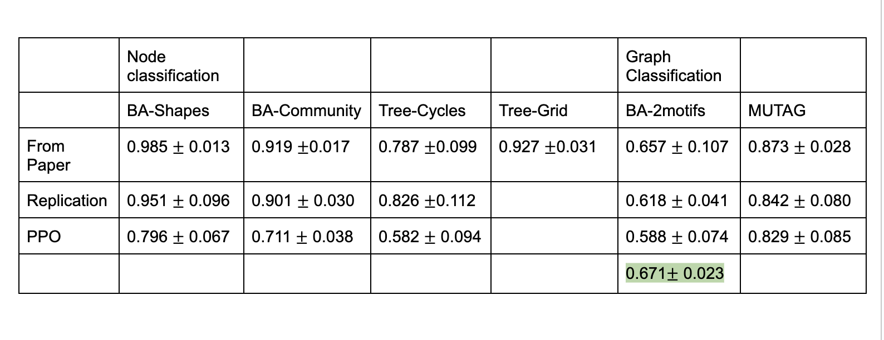

# Weekly Update  
**RL-Based GNN Explainer**  
Nathan Behailu

---

# RG-Explainer: Main Components

- **Seed selection**: choose a salient start node.  
- **Iterative graph generation**: grow a connected subgraph from the frontier.  
- **Stopping criteria learning**: learn when to halt.

> Scope today: **Iterative graph generation** (we keep seed + stop as in RG for now).

---

# Iterative Generation in RG (Baseline)

- **State:** partial subgraph $S_t$ + frontier $\partial S_t$
- **Action:** pick a node from $\partial S_t$ (or STOP)  
- **Reward:** negative explanation loss  

**RG loss (explanation quality):**
$$
L(S)=L_{\text{pred}}+\lambda_1 L_{\text{size}}+\lambda_2 L_{\text{radius}}+\lambda_3 L_{\text{sim}}
$$

**REINFORCE update:**
$$
\nabla_\theta J(\theta)
= \mathbb{E}\!\left[\sum_{t=1}^T \nabla_\theta \log \pi_\theta(a_t\mid s_t)\; Q(s_t,a_t)\right]
$$

---

# Monte-Carlo Rollouts in RG

Reward only available at the end → use rollouts:  
$$
Q(s_{t-1},a_t)\;\approx\;\tfrac{1}{M}\sum_{i=1}^{M} \big(-L(S^{(i)})\big)
$$
where each $S^{(i)}$ is a full subgraph sampled from the current policy.

---

# Our Modification

We replace **vanilla REINFORCE** with **PPO**.

**Policy ratio:**  
$$
r_t(\theta)=\frac{\pi_\theta(a_t\mid s_t)}{\pi_{\theta_{\text{old}}}(a_t\mid s_t)}
$$

**Clipped surrogate objective:**  
$$
L^{\text{CLIP}}
=\mathbb{E}\!\left[\min\!\Big(r_t A_t,\ \text{clip}(r_t,\,1-\epsilon,\,1+\epsilon)\,A_t\Big)\right]
$$

---

# PPO Loss 

**Total loss minimized:**
$$
\mathcal{L}
= -\,L^{\text{CLIP}}
+ c_v \cdot \tfrac{1}{2}\,\|V_\theta - R\|^2
- c_e \cdot H(\pi_\theta)
$$

- **Policy loss:** clipped surrogate  
- **Value loss:** clipped MSE  
- **Entropy bonus:** encourages exploration  
- With **KL stop** + **gradient clip** for stability

---

# Results

